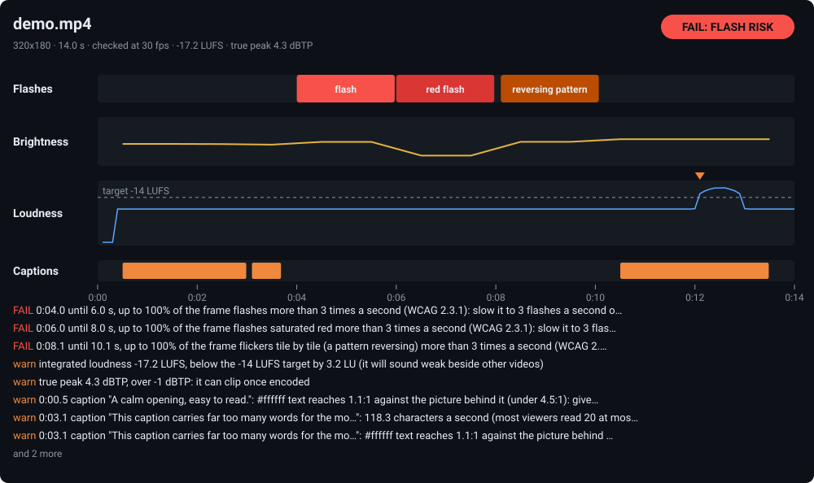

<div align="center">

# video-safety-check

**Find the flashes in a video that can trigger photosensitive seizures before you publish it, and in the same pass, captions nobody can read and sound that jumps out at people.**




[Why](#why) · [What it checks](#what-it-checks) · [Install](#install) · [Usage](#usage) · [How it works](#how-it-works) · [Limits](#limits)

</div>

---

One command, any video ffmpeg can read. It screens every frame for general flashes, saturated red flashes and reversing patterns against the WCAG 2.3.1 thresholds, measures loudness to EBU R128, and checks a subtitle file for reading speed, line length and contrast against the picture behind it. It prints what it found with timestamps and the fix, can draw the timeline above, and fails a CI build on request.

The report above is real: `scripts/make-demo.js` builds a 14-second test video with one problem in each stretch, and the tool found every one.

## Why

Broadcasters screen programmes for flashing before they air them, with Harding-style analysers, because flashing at the wrong rate can trigger seizures in people with photosensitive epilepsy. Almost nobody screens the videos made for YouTube, TikTok, Reels or a product launch, while edit tools make strobe cuts, glitch transitions and flash frames one-click effects.

The same videos often ship captions that flash past faster than anyone reads, white text over a white sky, and a sound effect 20 LU louder than the voice. Each of these can be measured, so this tool measures them.

## What it checks

| Check | Fails or warns when | Based on |
| --- | --- | --- |
| **Flashes** | more than 3 flashes in any one second, over more than a quarter of the frame, with a change of 0.1 or more in relative luminance and the darker state under 0.8 | [WCAG 2.3.1](https://www.w3.org/WAI/WCAG22/Understanding/three-flashes-or-below-threshold.html) (thresholds), [ITU-R BT.1702](https://www.itu.int/rec/R-REC-BT.1702) and [Ofcom's guidance](https://www.ofcom.org.uk/siteassets/resources/documents/tv-radio-and-on-demand/broadcast-guidance/gn_flash.pdf) (a quarter of the screen) |
| **Red flashes** | the same rate and area in saturated red (R / (R+G+B) at least 0.8), with WCAG's red measure (R − G − B) × 320 changing by more than 20, even when overall brightness barely moves | WCAG 2.3.1's red flash definition |
| **Reversing patterns** | over a quarter of the frame holds tiles that each swap between the same two states more than 3 times a second: checkerboards, stripes | the same thresholds, tile by tile |
| **Caption reading speed** | over 20 characters a second, under 5/6 s on screen, a line over 42 characters, more than 2 lines | common streaming and broadcast style guides ([Netflix](https://partnerhelp.netflixstudios.com/hc/en-us/articles/217350977-English-USA-Timed-Text-Style-Guide), [BBC](https://www.bbc.co.uk/accessibility/forproducts/guides/subtitles/)) |
| **Caption contrast** | the caption colour under 4.5:1 against the brightest part of the picture behind it, at the worst moment of the cue | [WCAG 1.4.3](https://www.w3.org/WAI/WCAG22/Understanding/contrast-minimum.html) |
| **Loudness** | integrated loudness more than 2 LU off the target, true peak over −1 dBTP, a sudden jump of 15 LU or more within a second | [EBU R128](https://tech.ebu.ch/publications/r128) / [ITU-R BS.1770](https://www.itu.int/rec/R-REC-BS.1770), measured by ffmpeg's `ebur128` filter |

A flash is a **FAIL** (exit code 1). Everything else is a **warning**, unless you pass `--strict`.

## Install

Node.js 18.17 or newer and **ffmpeg with ffprobe**, on Windows, macOS or Linux. No npm dependencies.

```sh
# ffmpeg: https://ffmpeg.org/download.html  (or: winget install ffmpeg / brew install ffmpeg / apt install ffmpeg)

# run it once, without installing
npx github:CosLynxAI/video-safety-check my-video.mp4

# or install the command
npm install -g github:CosLynxAI/video-safety-check

# or from source
git clone https://github.com/CosLynxAI/video-safety-check && cd video-safety-check
node bin/cli.js my-video.mp4
```

If ffmpeg is not on your PATH, set `FFMPEG_PATH` and `FFPROBE_PATH`.

## Usage

```
video-safety-check <video>... [--subtitles captions.srt] [--caption-color #ffffff] [--loudness streaming]
                              [--svg report.svg] [--json] [--strict]
```

| Option | Default | |
| --- | --- | --- |
| `--subtitles` | | an SRT, WebVTT or ASS file to check for reading speed, line length and contrast |
| `--caption-color` | `#ffffff` | the captions' text colour, for the contrast check |
| `--loudness` | `streaming` | the target: a LUFS number, or `streaming`, `youtube`, `spotify`, `tiktok`, `instagram` (−14), `apple`, `podcast` (−16), `ebu` (−23), `atsc` (−24) |
| `--svg` | | also write the report as an SVG timeline; with several videos, one file each |
| `--json` | off | print the full report as JSON |
| `--strict` | off | exit 1 on warnings too, not only on flashes |

Exit codes: `0` pass, `1` fail (a flash risk; with `--strict`, any warning), `2` the check could not run.

```sh
video-safety-check video.mp4 --subtitles video.vtt --caption-color "#ffff00"
video-safety-check video.mp4 --loudness ebu
video-safety-check *.mp4 --strict          # in CI
```

### A real run

The 14-second test video from `node scripts/make-demo.js demo`: a calm test pattern, a 5 Hz black-and-white strobe, 5 Hz red flashing at nearly steady brightness, a checkerboard reversing at 5 Hz, then a pale scene with a burst of noise and white captions over it.

```
$ video-safety-check demo/demo.mp4 --subtitles demo/demo.srt --svg report.svg
demo.mp4: 320x180, 14.0 s, checked at 30 fps
  loudness -17.2 LUFS (target -14), range 14.7 LU, true peak 4.3 dBTP
  3 captions from demo.srt

  warn           integrated loudness -17.2 LUFS, below the -14 LUFS target by 3.2 LU (it will sound weak beside other videos)
  warn           true peak 4.3 dBTP, over -1 dBTP: it can clip once encoded
  warn   0:00.5  caption "A calm opening, easy to read.": #ffffff text reaches 1.1:1 against the picture behind it (under 4.5:1): give it an outline, a shadow or a box
  warn   0:03.1  caption "This caption carries far too many words for the mo…": 118.3 characters a second (most viewers read 20 at most): hold it longer or cut words; on screen 0.60 s (under 0.83 s, too brief to read); a line of 71 characters (over 42): break it
  warn   0:03.1  caption "This caption carries far too many words for the mo…": #ffffff text reaches 1.1:1 against the picture behind it (under 4.5:1): give it an outline, a shadow or a box
  FAIL   0:04.0  until 6.0 s, up to 100% of the frame flashes more than 3 times a second (WCAG 2.3.1): slow it to 3 flashes a second or fewer, shrink it under a quarter of the frame, or lower its contrast
  FAIL   0:06.0  until 8.0 s, up to 100% of the frame flashes saturated red more than 3 times a second (WCAG 2.3.1): slow it to 3 flashes a second or fewer, shrink it under a quarter of the frame, or lower its contrast
  FAIL   0:08.1  until 10.1 s, up to 100% of the frame flickers tile by tile (a pattern reversing) more than 3 times a second (WCAG 2.3.1): slow it to 3 flashes a second or fewer, shrink it under a quarter of the frame, or lower its contrast
  warn   0:10.5  caption "White words over a pale sky.": #ffffff text reaches 1.3:1 against the picture behind it (under 4.5:1): give it an outline, a shadow or a box
  warn   0:12.1  sudden jump: up 21.7 LU within a second, to -4.2 LUFS (startling, and hard on headphone listeners)

FAIL: flashes that can trigger seizures
```

The first caption sits over the white bars of ffmpeg's test pattern, which is why it fails contrast too.

And a clean one, a 60-second 1080x1920 test video with a tone at −23 LUFS, checked in 1.7 s on a laptop:

```
$ video-safety-check calm.mp4 --loudness ebu
calm.mp4: 1080x1920, 60.0 s, checked at 30 fps
  loudness -22.9 LUFS (target -23), range 0 LU, true peak -12.9 dBTP
  no subtitle file given (--subtitles to check captions)

  nothing to report

PASS: no flash risk, nothing else off
```

### Output

- **Text** (above): one line per problem, with its time, what was measured and how to fix it, then the verdict.
- **`--svg`**: the timeline at the top of this page. Flashing stretches, brightness per second, momentary loudness against the target with each jump marked, and each caption cue, green or flagged.
- **`--json`**: the whole report. Its start, from the demo:

```json
{
 "file": "demo.mp4", "duration": 14, "width": 320, "height": 180, "fps": 30, "frames": 420,
 "flashes": [
  { "t": 4, "frame": 120, "share": 1, "kind": "general" },
  { "t": 6, "frame": 180, "share": 1, "kind": "red" },
  { "t": 8.1, "frame": 243, "share": 1, "kind": "pattern" }
 ],
 "loudness": { "integrated": -17.2, "range": 14.7, "truePeak": 4.3, "target": -14, "jumps": [{ "t": 12.1, "loudness": -4.2, "rise": 21.7 }] },
 "captions": null,
 "brightness": [ ... ],
 "issues": [ { "level": "fail", "at": 4, "what": "until 6.0 s, up to 100% of the frame flashes ..." } ],
 "verdict": "fail"
}
```

(shortened: `flashes` has one entry per flashing second, and `share` is the least share of the frame across that second's flashes.)

### From code

```js
const { checkVideo } = require("video-safety-check");

const r = await checkVideo("video.mp4", { subtitles: "video.srt", captionColor: "#ffffff", target: "youtube" });
r.verdict;   // "pass" | "warn" | "fail"
r.flashes;   // [{ t, frame, share, kind: "general" | "red" | "pattern" | "red-pattern" }]
r.issues;    // [{ level: "fail" | "warn" | "note", at, what }]
```

## How it works

**Flashes.** ffmpeg decodes the video at its own frame rate, capped at 60 fps (a 60 fps strobe read at 30 fps would alias into something calmer), and scales each frame so its long side is 192 px. The frame is cut into 6 × 6 px tiles, so film grain and hairlines average out. For every tile it follows two values on linear RGB: relative luminance (0.2126 R + 0.7152 G + 0.0722 B) and WCAG's red measure. A transition is a change of at least 0.1 in luminance with the darker state under 0.8, or of more than 20 in the red measure with one end saturated red; a flash is a pair of opposing transitions. A second fails in either of two ways:

- **The picture turns as a whole.** Over a quarter of the frame changes the same way at the same time, and that happens more than 3 times within a second, back and forth. This catches strobes and white or red flash frames. A fast move across text flips tiles both ways at once, so it does not turn the picture.
- **Its tiles flash on their own.** Over a quarter of the frame holds tiles that each flash more than 3 times within a second, trading between the same two peaks. This catches reversing checkerboards and stripes. Moving texture has peaks that wander from phase to phase, so it is not counted.

Flashing seconds of one kind that run on are reported as one stretch.

**Captions.** SRT, WebVTT and ASS are read by their content (ASS by its `Format:` line; tags and `\N` breaks handled). Reading speed counts characters with spaces collapsed, over the cue's duration. For contrast, each frame's tiles in the lower caption band (15-85 % across, 70-92 % down) give their 90th-percentile luminance, and the worst frame during the cue is compared with the caption colour by the WCAG contrast ratio.

**Loudness.** ffmpeg's `ebur128` filter with true peak gives integrated loudness, loudness range and true peak to EBU R128 / ITU-R BS.1770, and the momentary loudness (400 ms windows, every 100 ms). A jump is momentary loudness rising 15 LU or more within one second to at least 6 LU above the programme's integrated loudness; jumps within 2 s of each other count once. A silent track (−70 LUFS, the gate's floor) or no audio stream is noted and not judged.

The test suite builds synthetic cases that must pass (3 flashes a second, exactly a quarter of the frame flashing, a dim flicker, a still frame, a slow fade) and ones that must fail (a 5 Hz strobe, red flashing at steady brightness, a reversing checkerboard), plus a full end-to-end run on the demo video when ffmpeg is installed.

## Limits

- **A screening tool, not a certified Harding test.** Where a broadcaster requires a certified analyser, use one. A pass means none of these checks found a problem; it does not prove a video is safe for everyone.
- **The area rule is the broadcast one.** It fails flashing over a quarter of the frame, as ITU-R BT.1702 and Ofcom do. WCAG's own area limit is smaller (25 % of any 10° visual field, about 341 × 256 px on a 1024 × 768 screen), so a small flashing region can pass here and still fail WCAG at a close viewing distance.
- **No spatial pattern rule.** Static striped patterns (the BT.1702 pattern guidance) are not judged; only patterns that reverse over time are.
- **Captions** are checked from the subtitle file you give it, in the usual lower band of the frame. Captions burned into the picture are not detected, and a caption placed elsewhere is measured against the wrong part of the picture.
- **Loudness targets** are what platforms normalise to; a platform can change its target.

## Development

```sh
npm test                                     # unit tests, plus an end-to-end run when ffmpeg is installed
node scripts/make-demo.js demo               # the 14 s test video and its subtitles
node bin/cli.js demo/demo.mp4 --subtitles demo/demo.srt --svg docs/report.svg
```

## Contributing

Issues and pull requests are welcome. The most useful report is a real video the tool gets wrong, a false positive or a miss, with the time it happens. A fix comes with a synthetic case in `test/check.test.js` that fails before it and passes after.

## Licence

MIT, see [LICENSE](LICENSE).

## Made by Coslynx

[Coslynx](https://coslynx.com) makes Content Factory, software that makes explainer reels on your own computer with your own Claude plan. We built this check while making it, and keep it open.
